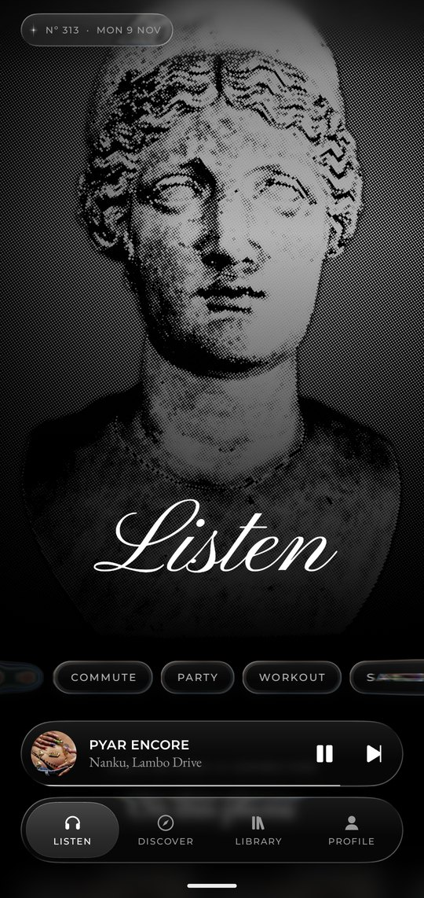
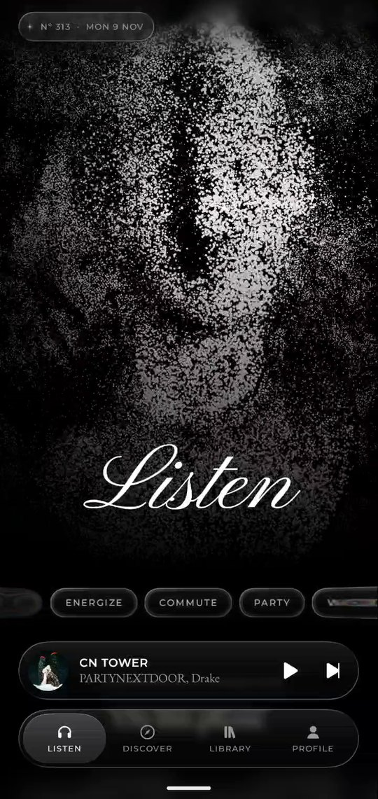
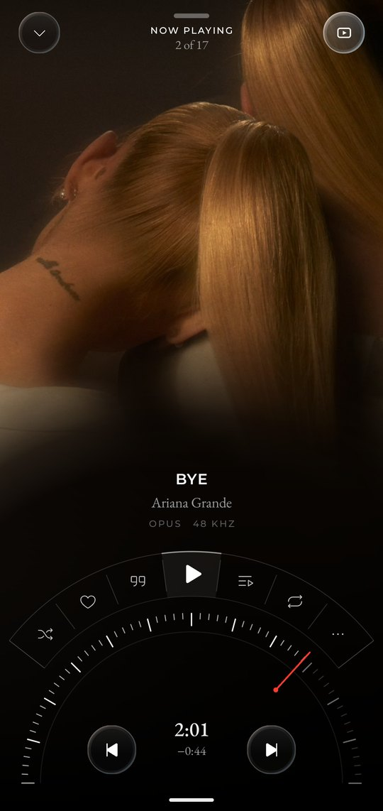
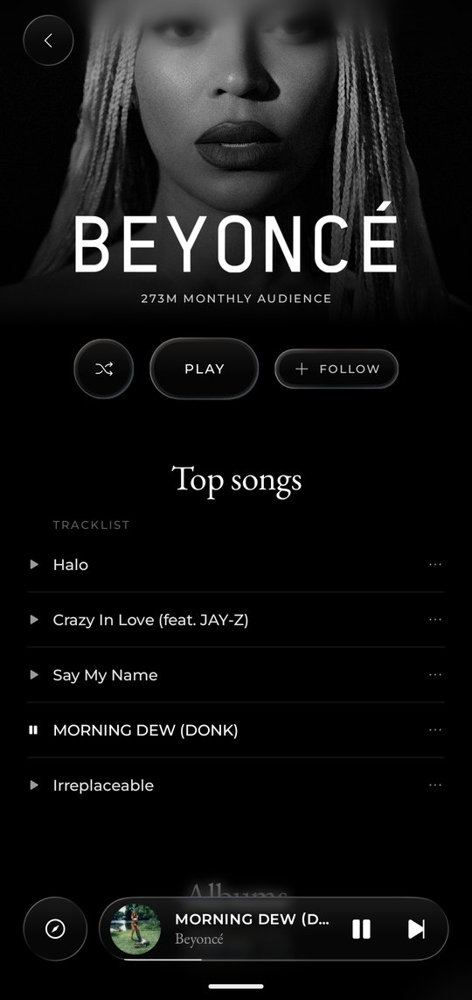
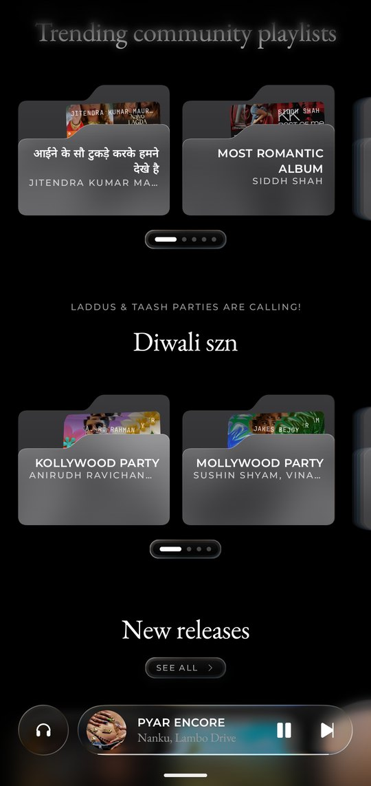
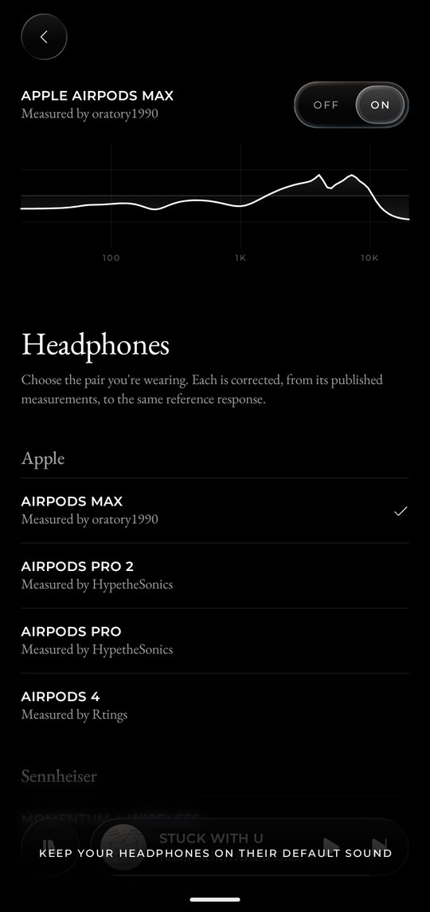
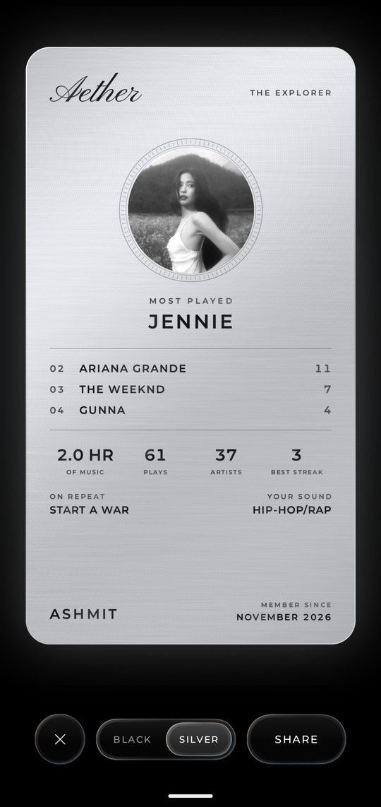
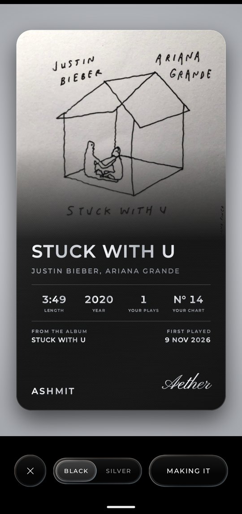

<h1 align="center">Aura Music</h1>

<p align="center">
<b>A premium native music player for Android.</b><br>
Built around the sound. Unlike anything you've used.
</p>

<p align="center">
  <a href="https://quick-maple-l6t3qaq.tmp.now"></a>
  <a href="https://github.com/vampireanshuman/Aura-Music/releases/latest/download/Aura-Music-v2.0.0.apk"></a>
  <a href="https://github.com/vampireanshuman/Aura-Music/releases/latest"></a>
  <a href="LICENSE"></a>
  
</p>

> [!NOTE]
> **Attribution & Licensing:**
> Aura Music is built on and powered by **[AETHER by GHOSTxASR](https://github.com/GHOSTxASR/AETHER)** under the **[GNU General Public License v3.0 (GPL-3.0)](LICENSE)**. All credit for the underlying architectural design, native Kotlin / Jetpack Compose implementation, AGSL GPU shaders, bit-perfect DAC audio engine, and AutoEq headphone calibration belongs to **GHOSTxASR** and upstream contributors.

<p align="center">
  
  
  
  
</p>

<p align="center">
  
  
  
  
</p>

Aura is made the way a fine watch is made: every part considered, nothing there for show. Pure black. One glass. Three typefaces. The only colour on the screen comes from the music you're playing.

It plays all of YouTube Music and your own files through an audio path that reports exactly what it measured, in an interface no other music app looks or moves like.

<p align="center"><a href="https://quick-maple-l6t3qaq.tmp.now"><b>Interactive Website & Audio Bench</b></a> &bull; <a href="https://github.com/vampireanshuman/Aura-Music/releases/latest">Releases</a></p>

## Download

1. Download **[Aura-Music-v2.0.0.apk](https://github.com/vampireanshuman/Aura-Music/releases/latest/download/Aura-Music-v2.0.0.apk)** from the latest release.
2. Open it on your phone. Android asks once to allow installs from your browser or file manager.
3. Open Aura and press play.

Needs Android 10 or later. Every release is signed with the same persistent key, so new versions install over old ones and keep your library.

## Zero nonsense

- **No ads, no tracking, no analytics.** Not one telemetry or crash-reporting SDK.
- **No account and no server of ours.** Your likes, playlists, history and statistics live on your phone.
- **No paywalls, no upsells, no nagging.** Everything is there from the first launch.
- **No claim it can't prove.** "Lossless", "Hi-Res" and "Bit-perfect" appear only when the decoder measured it or the path was verified. Switch on a tuning and "Bit-perfect" takes itself away.
- **No dead ends.** No placeholder content and no button without an action. If a source can't do something, the app says so.

## Quality first

**An honest signal path.** Audio leaves the decoder as float where the device takes it, so nothing above 16 bits is cut, and the app never resamples. With a USB DAC on Android 14 or later, the path goes bit-perfect, and the label appears only once the phone confirms it.

**An equaliser that knows your headphones.** Choose the pair you're wearing from 39 models, including AirPods Max and Pro, Sennheiser, Sony, Marshall and Bose, and it applies a correction made from that model's published measurements. Seven tunings of our own are there too, and profiles from AutoEq, squig.link, Equalizer APO or Wavelet import in a tap. Boosts can't clip, and with nothing chosen every sample passes through untouched.

**Your whole library.** The complete YouTube Music catalogue, as a guest or signed in on Google's own page. Your own FLAC, ALAC and WAV files, as albums and folder by folder. Songs and whole playlists kept for offline, as files in your Music folder, picking up new additions on Wi-Fi. Your own sources, added by address over an open protocol.

**The best copy there is.** For a song from YouTube Music, your own sources are asked for the very same recording first, lossless where they have it. When one turns up while the song plays, Aura goes over to it mid-song, lined up by its sound and handed over in a crossfade you shouldn't hear.

**Songs that meet.** Crossfade of 2 to 12 seconds, never between an album's songs that run into each other.

## Features

**Statues that rearrange themselves.** Behind Listen stand twelve figures from antiquity, printed in halftone. Every nine seconds, each dot lifts, crosses the screen and lands as part of the next god, with the face arriving last.

**A dial, in place of a progress bar.** Now Playing is an instrument: an arc of fine marks and a red needle you take in your hand.

**Covers that move.** Where an album has a film, the cover gives way to it in full colour, fading along an arc that follows the dial. On a slow connection, the cover simply stays.

**Metal you can send.** Your listening engraved on a black or brushed silver charge card, and any song on a card of its own, exported at story size.

**A song going into the phone.** Keep a song and its cover lifts off, carries to the foot of the screen and sinks in, and the whole display ripples as it lands.

**Lyrics, three ways.** From seven libraries at once, word by word where one has it: a page that's sung, each word lighting as it's sung and a held note glowing; words as a night sky of constellations; or the entire song written as one unbroken line. Korean, Chinese and Japanese come in Latin letters too, worked out on the phone.

**A portrait of how you listen.** Your most played artists as a deck to throw aside, your day as a dial, your genres and habits, all worked out on the phone and shown to nobody else.

**One glass, and real physics.** Everything you can touch is the same liquid glass, bending what's behind it. Every movement runs on Apple's spring physics, so a gesture interrupted keeps its speed.

## Privacy

Your YouTube sign-in is sealed with the Android Keystore, and a card leaves the phone only when you send it. Apart from fetching music, Aura makes four kinds of request. Each can be turned off in Settings, and none says anything about you.

| For | Asks | Sends |
|---|---|---|
| Timed lyrics | lrc.red, BiniLyrics, BetterLyrics, LyricsPlus, Unison, LRCLIB and KuGou, each one switchable | A song's title, artist, album and length |
| Artist and album art | Apple's public pages | An artist's name and an album's title |
| Song video | Apple's public pages | A song's title and artist |
| Updates | GitHub's list of Aura's releases | Nothing: it reads the newest release's number |

## Principles

Quality is measured, never claimed. Added sources play open media only: no content-key decryption, no licence proxies, no sources bundled with the app. Every change is judged first by how it looks and feels on the phone.

## Building

Runs on Android 10 or later, in portrait. To build it you need JDK 17 or later and the Android SDK with API 37, with `local.properties` pointing at the SDK.

```sh
./gradlew :app:installDebug                                          # build and install on a phone
./gradlew :ytmusic:test :core:model:test :player:testDebugUnitTest   # unit tests
./gradlew :ytmusic:liveCheck                                         # check every YouTube Music surface live
./gradlew :app:assembleRelease                                       # release APK
```

A release build is signed with the key named in `keystore.properties`, which stays out of git; without one the APK comes out unsigned. Publishing is written up in [`docs/releasing.md`](docs/releasing.md). AGSL shaders need Android 13, and the dot morph and bit-perfect output need 14. Older phones fall back quietly.

| Module | What it holds |
|---|---|
| `app` | Navigation and screens |
| `player` | The Media3 service, queue, downloads, equaliser, bit-perfect route |
| `core:model` | Plain types, the `MusicSource` interface, equaliser maths and file parsing |
| `core:data` | Room database, settings, the source manager |
| `core:designsystem` | Tokens, type, glass and its physics, shaders, components |
| `core:lyrics` | Lyrics lookup |
| `ytmusic` | The YouTube Music client and its fail-soft parser |
| `sources:*` | YouTube, the phone, addons, and Apple's public art |

## Credits

Aura Music is built upon [AETHER by GHOSTxASR](https://github.com/GHOSTxASR/AETHER) (GPL-3.0), PODIUM, LastWave-native and BitChord (GPL-3.0), Kyant's Backdrop, Media3, Coil, [AutoEq](https://github.com/jaakkopasanen/AutoEq) and the people who measured the headphones, and Phosphor Icons. Everything is listed with its licence in [`third_party/NOTICES.md`](third_party/NOTICES.md), and the statue photographers in [`third_party/STATUE_PHOTOS.md`](third_party/STATUE_PHOTOS.md).

## Licence

[GPL-3.0](LICENSE). Third-party parts keep their own licences and notices.

Aura is an independent project. It isn't affiliated with or endorsed by YouTube, Google, Apple or any headphone maker named here, and all music, artwork and trademarks belong to their owners.
